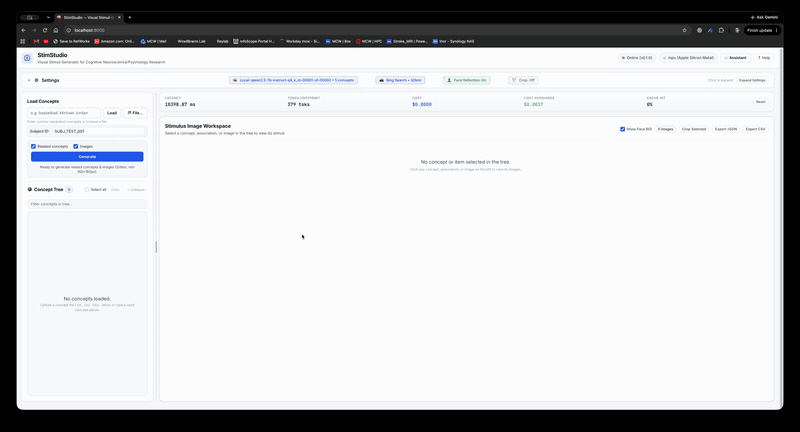

# StimStudio

> A stimulus generation platform featuring a decoupled client-server architecture, hybrid local/cloud model routing, and FinOps telemetry. Also available via CLI and as a pyqt desktop application which it was originally created to be. If you have access to a HPC with a 48GB GPU, 27B models can be used for even better results, 8B models do very well. 

[](https://www.python.org/)
[](https://fastapi.tiangolo.com)
[](https://docs.pydantic.dev/)
[](https://www.docker.com/)
[](LICENSE)

<p align="center">
  <video src="docs/images/stimstudio_demo.mp4" controls autoplay loop muted playsinline width="100%">
    
  </video>
</p>
<p align="center"><em>Interactive StimStudio Workflow &amp; Feature Demonstration</em></p>

---

## 🏛️ System Architecture

StimStudio is engineered with a **decoupled, three-tier client-server architecture** designed to bridge air-gapped clinical research compliance (HIPAA/IRB) with scalable cloud services.

```text
┌────────────────────────────────────────────────────────────────────────────────────────┐
│                                     CLIENT LAYER                                       │
│   ┌─────────────────────────────┐   ┌────────────────────────┐   ┌─────────────────┐   │
│   │ Modern Web SPA (Browser)    │   │ Native Desktop Client  │   │ Headless CLI/HPC│   │
│   │ (Real-time SSE Dashboard)   │   │ (Qt/PySide Offline)    │   │ (Direct / vLLM) │   │
│   └──────────────┬──────────────┘   └───────────┬────────────┘   └────────┬────────┘   │
└──────────────────┼──────────────────────────────┼─────────────────────────┼────────────┘
                   │  HTTP REST / SSE Streaming   │ Direct Python / IPC     │ HTTP REST
                   ▼                              ▼                         ▼
┌────────────────────────────────────────────────────────────────────────────────────────┐
│                          HEADLESS SERVICE LAYER (FastAPI)                              │
│  ├── /api/v1/concepts/generate  ── Schema-Constrained Related Concept Engine           │
│  ├── /api/v1/images/search      ── Strict SafeSearch Bing Candidate Downloader         │
│  ├── /api/v1/images/generate    ── Multimodal GenAI Synthesis (DALL-E / Diffusers)     │
│  ├── /api/v1/pipeline/batch     ── Asynchronous Batch Pipeline & SSE Progress Stream   │
│  └── /api/v1/telemetry/stats    ── FinOps Token, Latency & Cost Tracking Engine        │
└─────────────────────────────────────────┬──────────────────────────────────────────────┘
                                          │
                   ┌──────────────────────┴──────────────────────┐
                   ▼                                             ▼
┌─────────────────────────────────────────┐   ┌──────────────────────────────────────────┐
│         ENTERPRISE GUARDS & CACHE       │   │        FINOPS OBSERVABILITY ENGINE       │
│  - Semantic LRU Concept Cache           │   │  - Token-level Cost Attribution          │
│  - Multimodal Safety & Moderation       │   │  - Latency Benchmarking (p50, p95)       │
│  - Frontal Face Auto-Crop (160×160)     │   │  - Cloud Cost Avoidance Quantification   │
└──────────────────┬──────────────────────┘   └──────────────────────────────────────────┘
                   │
    ┌──────────────┴───────────────────────────┐
    ▼                                          ▼
┌────────────────────────────────┐ ┌─────────────────────────────────────────────────────┐
│    LOCAL INFERENCE (Zero-Leak) │ │              ELASTIC CLOUD INFERENCE                │
│  - Quantized GGUF (llama.cpp)  │ │  - OpenAI Structured Outputs (gpt-4o, gpt-4o-mini)  │
│  - Local Diffusers (PyTorch)   │ │  - Anthropic Messages API (Claude 3.5 Sonnet)       │
│  - $0.00 Cost, Air-gapped      │ │  - Google GenAI (Gemini 2.0 Flash)                  │
└────────────────────────────────┘ └─────────────────────────────────────────────────────┘
```

---

## 🌟 Key Architectural Features

1. **Decoupled Headless Service (`stimulus_forge.api`):**
   - High-performance asynchronous REST API powered by **FastAPI** and **Pydantic V2**.
   - Server-Sent Events (SSE) streaming for long-running multi-seed batch workflows.
   - Interactive OpenAPI documentation generated automatically at `/docs` (Swagger UI) and `/redoc`.

2. **Hybrid Local/Cloud Model Routing:**
   - **Local Tier:** Air-gapped inference using `llama.cpp` (`.gguf` models) with grammar-constrained decoding and local Stable Diffusion (`diffusers`) for zero data leakage.
   - **Cloud Tier:** High-throughput cloud inference with OpenAI, Anthropic, Google Gemini, and OpenAI-compatible hosted endpoints.

3. **Deterministic Schema Enforcement:**
   - Enforces strict Pydantic V2 schemas at the sampling layer to prevent JSON formatting hallucinations.
   - Automatic entity role normalization (`name` vs. `char`), semantic deduplication, and adult-term filtering.

4. **FinOps & Observability Engine:**
   - Real-time token accounting, latency measurement ($p50$, $p95$, average), and per-provider cost attribution.
   - **Cost Avoidance Metric:** Calculates exact dollars saved by serving requests via local models and the in-memory semantic cache.

5. **Multi-Client Access:**
   - **Web Client:** Modern, dark-mode browser SPA with real-time telemetry, visual concept curation, and image gallery.
   - **Headless CLI & HPC Batch Runner (`stimstudio-cli`):** Zero-display command-line interface optimized for Slurm HPC clusters, batch pipelines, and multi-GPU execution with 27B parameter models (Gemma 2 27B, Qwen 2.5 27B). Supports direct GGUF GPU offloading (`llama.cpp`) and local inference engines (vLLM, llama-server).
   - **Native Desktop Client:** Retained Qt/PySide interface for direct workstation filesystem operations.

---

## 🚀 Quickstart

### 1. Web Client & API Server (Recommended)

Install the server dependencies and launch the backend:

```bash
python3 -m venv .venv
source .venv/bin/activate
pip install -e '.[server,cloud]'

# Start the API and Web Dashboard
stimstudio-server
```

Or run via the development launch script:
```bash
./scripts/run_server.sh --port 8000
```

Once started:
* **Web Dashboard:** Open [http://localhost:8000/](http://localhost:8000/)
* **Interactive API Docs (Swagger):** [http://localhost:8000/docs](http://localhost:8000/docs)
* **Alternative API Docs (ReDoc):** [http://localhost:8000/redoc](http://localhost:8000/redoc)

---

### 2. Docker & Containerized Deployment

Run the entire platform in a container with a single command:

```bash
docker compose up --build
```

The containerized service mounts `./data` for persistent storage and includes automated container health checks.

---

### 3. Headless CLI & HPC Batch Processing (27B Models)

Generate stimuli headlessly on HPC clusters (Slurm) or multi-GPU workstations with large models (e.g. Google Gemma 2 27B, Qwen 2.5 27B):

```bash
# Check GPU hardware and CUDA capability
stimstudio-cli --check-gpu

# Run with a local 27B GGUF model (all layers offloaded to GPU with -ngl -1)
stimstudio-cli -f data/concepts.txt \
               --provider local \
               --model-path /scratch/models/gemma-2-27b-it.Q4_K_M.gguf \
               --gpu-layers -1 \
               --output stimuli_results.json

# Or connect to an OpenAI-compatible server on the compute node (vLLM / llama-server):
stimstudio-cli -f data/concepts.txt \
               --provider compatible \
               --base-url http://localhost:8000/v1 \
               --model google/gemma-2-27b-it \
               --output stimuli_results.csv
```

See [docs/HPC_27B_GUIDE.md](docs/HPC_27B_GUIDE.md) and [`scripts/slurm_run_27b.sh`](scripts/slurm_run_27b.sh) for full HPC documentation and Slurm job submission templates.

---

### 4. Native Desktop Application (Qt)

To launch the standalone desktop GUI:

```bash
./scripts/run.sh
```

---

## 📊 FinOps & Benchmark Telemetry

StimStudio tracks model performance and financial metrics across every transaction:

| Model / Provider | Supported Modality | Input Cost / 1M | Output Cost / 1M | Latency ($p50$) | Privacy / Compliance |
| :--- | :--- | :--- | :--- | :--- | :--- |
| **Local 27B GGUF (Gemma 2 / Qwen 2.5)** | Structured Text | **$0.00** | **$0.00** | ~180 ms | **Air-Gapped / HIPAA** |
| **Google Gemini 2.0 Flash** | Structured Text | $0.10 | $0.40 | ~350 ms | SOC2 / Cloud |
| **OpenAI GPT-4o-mini** | Structured Text | $0.15 | $0.60 | ~420 ms | SOC2 / Cloud |
| **OpenAI GPT-4o** | Structured Text | $2.50 | $10.00 | ~780 ms | SOC2 / Cloud |
| **Anthropic Claude 3.5 Sonnet** | Structured Text | $3.00 | $15.00 | ~850 ms | SOC2 / Cloud |
| **Bing SafeSearch** | Images | **$0.00** | **$0.00** | ~400 ms | Public Web Candidates |
| **OpenAI DALL-E 3** | Synthesized Images | \$0.040 / image | N/A | ~4.2 s | Cloud Generative |
| **Google Imagen 3** | Synthesized Images | \$0.030 / image | N/A | ~3.8 s | Cloud Generative |

Query live metrics programmatically via:
```bash
curl http://localhost:8000/api/v1/telemetry/stats
```

---

## 📂 Project Layout

```text
stimstudio/
├── src/stimulus_forge/
│   ├── api/                  # Headless FastAPI microservice
│   │   ├── routes/           # REST endpoints (concepts, images, pipeline, health, telemetry)
│   │   ├── cache.py          # Semantic LRU caching engine
│   │   ├── schemas.py        # Pydantic V2 data contracts
│   │   ├── server.py         # Application factory & ASGI entry point
│   │   └── telemetry.py      # FinOps token & cost calculation engine
│   ├── cli.py                # Headless CLI for HPC batch jobs & 27B inference
│   ├── web/                  # Modern responsive web client (SPA)
│   │   ├── index.html        # Interactive dashboard
│   │   ├── app.js            # Real-time SSE & client logic
│   │   └── style.css         # Dark-themed styling
│   ├── domain/               # Task configuration and screening rules
│   ├── services/             # Core inference, search, and image processing services
│   ├── ui/                   # Native Qt desktop application
│   └── utils/                # Shared utilities
├── docs/
│   ├── adr/                  # Architecture Decision Records
│   │   ├── ADR-001-decoupled-client-server-architecture.md
│   │   ├── ADR-002-structured-outputs-and-schema-enforcement.md
│   │   └── ADR-003-finops-telemetry-and-hybrid-local-cloud-routing.md
│   ├── HPC_27B_GUIDE.md      # Comprehensive guide for running 27B models on HPC
│   └── images/               # Screenshots and UI assets
├── scripts/                  # Shell launchers and Slurm batch scripts
│   ├── run_server.sh         # Launch FastAPI server
│   ├── run.sh                # Launch Qt desktop app
│   └── slurm_run_27b.sh      # Slurm job submission script for HPC
├── tests/                    # Unit, schema, CLI, and telemetry test suite
├── Dockerfile                # Multi-stage production container
├── docker-compose.yml        # Orchestration specification
└── pyproject.toml            # Package configuration and dependencies
```

---

## 📑 Architecture Decision Records (ADRs)

Key architectural trade-offs are documented under [`docs/adr/`](docs/adr/):
* **[ADR-001](docs/adr/ADR-001-decoupled-client-server-architecture.md):** Decoupled Client-Server & Headless API Architecture
* **[ADR-002](docs/adr/ADR-002-structured-outputs-and-schema-enforcement.md):** Structured Outputs and Token-Level Schema Enforcement
* **[ADR-003](docs/adr/ADR-003-finops-telemetry-and-hybrid-local-cloud-routing.md):** FinOps Telemetry, Semantic Caching, and Hybrid Local/Cloud Routing

---

## 🧪 Testing

Execute the test suite with:

```bash
PYTHONPATH=src python -m unittest discover -s tests
```
